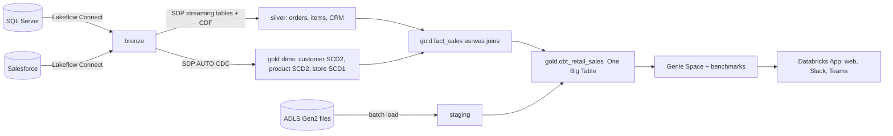

# Retail Lakehouse on Databricks

End-to-end retail analytics platform: **Lakeflow Connect → ADLS staging → Spark Declarative Pipelines (SCD1/SCD2) → One Big Table → Genie Spaces → Databricks App (Slack / Teams) with Docker-based CI/CD**.

Built around 15–20 GB/day of operational data from SQL Server (orders, items, customers, products, stores) and Salesforce (contacts, cases), plus daily ADLS files (inventory snapshots, returns).



## Repo layout

| Path | What it does |
|---|---|
| `data_generator/` | Synthetic retail data for all three feeds (initial + incremental/CDC-like days) |
| `src/setup/` | Catalog/schemas DDL, `simulate_bronze.py` (dev stand-in for Lakeflow Connect), CDF enablement |
| `resources/lakeflow_connect.yml` | Managed ingestion pipelines for SQL Server (gateway) and Salesforce |
| `src/batch/load_adls_to_staging.py` | ADLS Gen2 → staging, explicit schemas, idempotent `replaceWhere` |
| `src/pipelines/sdp/transformations/` | SDP: silver streaming tables, **SCD1/SCD2** dims, as-was fact |
| `src/batch/build_obt.py` | Incremental One Big Table build |
| `src/optimize/optimize_tables.py` | Z-ORDER, compaction, stats, vacuum |
| `src/genie/` | Genie space config + creator + **benchmark runner** (accuracy gate) |
| `app/` | FastAPI Databricks App: web chat, Slack slash command, Teams webhook; `Dockerfile` |
| `resources/*.yml`, `databricks.yml` | Asset Bundle: pipeline, 3 jobs, app, dev/prod targets |
| `.github/workflows/` | CI (lint, tests, bundle validate, docker smoke test) and CD (image push, deploy, Genie gate) |

## Quick start (dev, no source systems needed)

```bash
pip install -r requirements-dev.txt && pytest -q

# 1. generate data (day 1 = full load + 30 days of orders)
python data_generator/generate_retail_data.py --mode initial --date 2026-11-12 --out out

# 2. configure the bundle: edit databricks.yml (workspace host, catalog, warehouse_id)
databricks bundle validate -t dev && databricks bundle deploy -t dev

# 3. create objects + upload data to the landing volume
#    run src/setup/00_create_objects.sql (replace ${catalog}), then:
databricks fs cp -r out dbfs:/Volumes/<catalog>/landing/raw --overwrite

# 4. simulate Lakeflow Connect (dev only), then run the pipeline
#    run src/setup/simulate_bronze.py <catalog> 2026-11-12   (as a job/notebook task)
databricks bundle run daily_retail_etl -t dev --params ingest_date=2026-11-12

# 5. see SCD2 in action: generate day 2 (changed customers/products + order status updates), re-run 4
python data_generator/generate_retail_data.py --mode incremental --date 2026-11-13 --out out

# 6. Genie + app
python src/genie/create_genie_space.py --catalog <catalog> --warehouse-id <id>
#    put the space id into databricks.yml (genie_space_id), then:
databricks bundle deploy -t dev && databricks bundle run retail_genie_app -t dev
python src/genie/run_benchmarks.py --space-id <id> --catalog <catalog> --warehouse-id <id>
```

**Production:** deploy `lakeflow_connect.yml` (create the UC connections first), enable CDF with
`src/setup/enable_cdf_on_bronze.py`, and add the ingestion pipeline tasks ahead of `load_staging` in `jobs.yml`
(commented example included). `simulate_bronze.py` is not used.

## Design notes

* **SCD1 vs SCD2** – `dim_store`, `silver.orders`, `silver.crm_contact` use SCD1 (current state). `dim_customer`
  tracks `city/state/loyalty_tier`; `dim_product` tracks `list_price/unit_cost/category/brand` as SCD2 (`__START_AT/__END_AT`).
  `fact_sales` joins on `order_ts BETWEEN __START_AT AND __END_AT` so history is "as-was" (e.g. `loyalty_tier_at_purchase`).
* **Why CDF on bronze** – Lakeflow Connect tables are updated in place; reading the change feed gives SDP the
  row-level inserts/updates/deletes that AUTO CDC needs.
* **OBT** – order-line grain, partitioned by `order_date`, rebuilt only for the trailing N days via `replaceWhere`.
* **Genie** – built on Gold only, with text instructions (revenue definition, return rate, week start) and
  benchmark SQL. `run_benchmarks.py` re-asks each question through the Conversation API and compares result sets,
  failing the release if accuracy < 80 %.
* **Slack / Teams** – the app verifies Slack signatures (with replay window) and Teams HMAC, acks Slack within 3 s and answers via `response_url`.
  Register `/slack/commands` as a slash command and `/teams/messages` as a Teams outgoing webhook, store secrets in the `retail-app` secret scope.
* **CI/CD & Docker** – CI builds the image and smoke-tests `/healthz`; CD pushes an immutable SHA-tagged image and
  deploys the bundle. Note: Databricks Apps itself runs from the source files in `app/` (`app.yaml` +
  `requirements.txt`), so the container is the reproducible build/test/scan artifact and local-parity runtime, and
  the bundle deploy ships the same commit. See `docs/performance.md` for tuning details.

## Things to verify in your workspace

These touch preview or fast-moving APIs; I could only test the generator and app logic locally (`pytest` passes), not on a live workspace:
`ingestion_definition` YAML, the Genie `serialized_space` JSON schema, the `genie_space` app resource, and SDP's
`dp.create_auto_cdc_flow` argument names on your runtime channel. Spark node types/versions in `databricks.yml` are placeholders (Azure).
